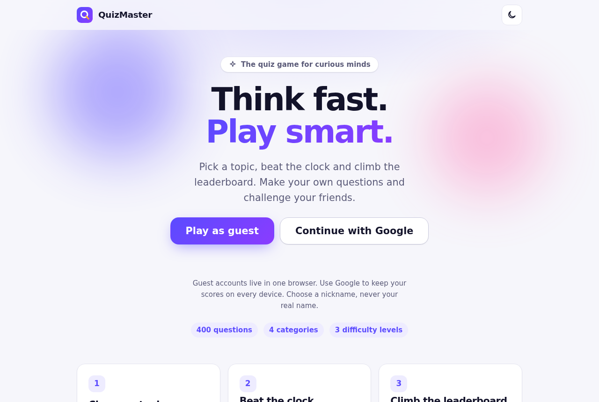
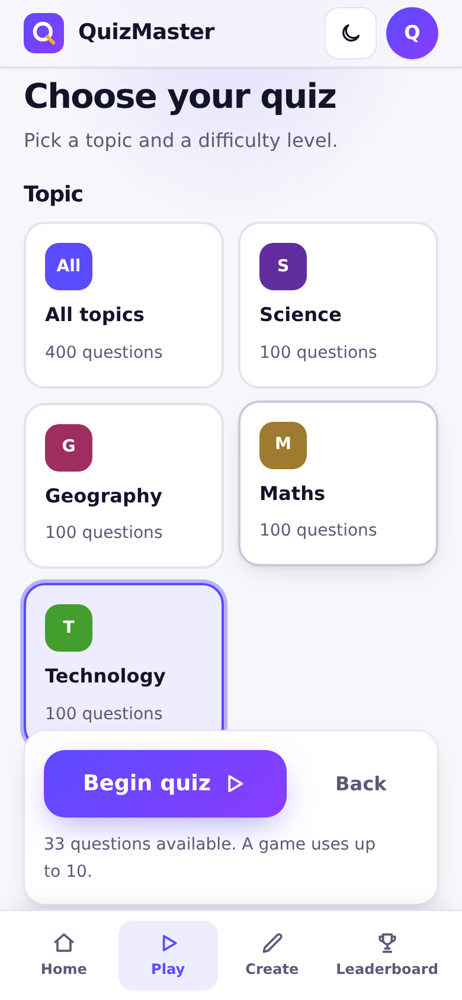
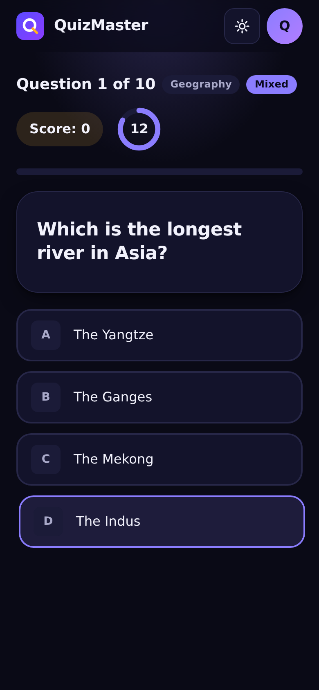

<div align="center">

<picture>
  <source media="(prefers-color-scheme: dark)" srcset="docs/assets/logo-dark.svg">
  
</picture>

# QuizMaster

**Think fast. Play smart.**<br>
A quiz game with 400 questions, difficulty levels, a countdown timer and an online leaderboard.

[](https://github.com/babatundeawo/quizmaster/actions/workflows/deploy.yml)
[](https://github.com/babatundeawo/quizmaster/actions/workflows/codeql.yml)

[**Play now**](https://babatundeawo.github.io/quizmaster/) · [Documentation](docs/) · [Report an issue](../../issues)

</div>

<p align="center">
  
</p>

<p align="center">
  
  &nbsp;&nbsp;
  
</p>

## About

QuizMaster is a free quiz game for curious players of all ages. Pick a topic and a difficulty level, answer before the timer runs out, and see how your score compares on the online leaderboard. Players can also write their own questions for everyone to enjoy.

## Features

- **400 questions** in four topics: Science, Geography, Maths and Technology, with easy, medium and hard levels
- **Countdown timer** and instant feedback on every answer
- **Online leaderboard** with a separate top 10 for each difficulty level
- **Create your own questions**, shared with every player
- **Player profiles** with a nickname, best score and games played
- **Light and dark themes** that follow your device
- **Works on phones and computers**, and installs like an app
- **Plays offline** with the built-in questions once it has been opened online
- **Keyboard friendly**: answer with the keys 1 to 4 or A to D

## How to use it

1. **Open the game** and choose **Play as guest** or **Continue with Google**. Guest accounts stay in one browser; Google keeps your scores on every device.
2. **Choose a nickname.** Please use a nickname, not your real name.
3. **Start a quiz.** Pick a topic and a difficulty level, then press **Begin quiz**. Each game has up to 10 questions.
4. **Answer before the ring runs out.** Tap an answer, or press 1 to 4 on a keyboard.
5. **See your result** and open the **Leaderboard**. Use the tabs to compare scores at the Easy, Medium, Hard and Mixed levels.
6. **Create questions** from the Create tab. Your questions appear for all players.

### Install on a phone

- **Android (Chrome):** open the game, tap the three-dot menu, then **Install app**.
- **iPhone (Safari):** open the game, tap **Share**, then **Add to Home Screen**.

## Tech stack

- HTML, CSS and JavaScript, with no framework and no build tools for the app itself
- [Firebase](https://firebase.google.com/) Authentication and Firestore for players, questions and scores
- A web app manifest and a service worker, so the game installs and works offline
- GitHub Actions and GitHub Pages for automatic checks and publishing

## Project structure

```text
.
├── index.html            The game (every screen lives here)
├── privacy.html          What the game stores, in plain language
├── 404.html              Page shown for unknown addresses
├── manifest.json         Makes the game installable
├── service-worker.js     Saves a copy of the game for offline use
├── firestore.rules       Security rules for the database
├── css/
│   ├── tokens.css        Colours, type, spacing and motion in one place
│   └── style.css         Layout and components
├── js/
│   ├── app.js            Game logic and screens
│   ├── effects.js        Theme switch, toasts, confetti
│   ├── questions.js      The 400 built-in questions
│   ├── firebase-config.js  Database and sign-in functions
│   └── firebase-env.js   Project settings (filled in during the build)
├── assets/images/        Icons and the social preview image
├── docs/                 Guides for running and customising the site
└── .github/              Automatic checks, publishing and security scans
```

## Contributing

Found a bug or have an idea for a new question topic? [Open an issue](../../issues/new/choose) or send a pull request. [CONTRIBUTING.md](CONTRIBUTING.md) explains how, using only the GitHub website.

## Security

Please report vulnerabilities privately. See [SECURITY.md](SECURITY.md).

## Credits

- Typefaces: [Sora](https://fonts.google.com/specimen/Sora) and [Inter](https://fonts.google.com/specimen/Inter), both licensed under the [SIL Open Font License 1.1](https://openfontlicense.org/)
- Icons and logo: drawn for this project
- Built with [Firebase](https://firebase.google.com/) and hosted on [GitHub Pages](https://pages.github.com/)
